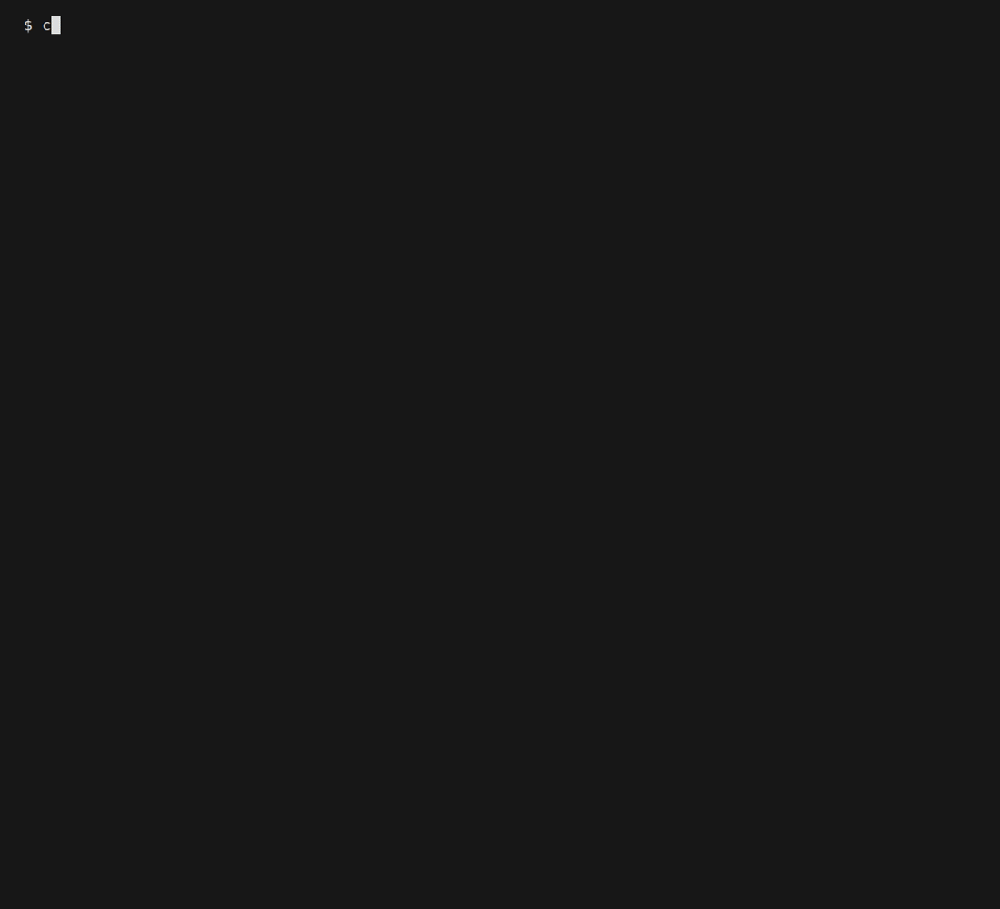

<!-- ALL-CONTRIBUTORS-BADGE:START - Do not remove or modify this section -->
[](#contributors-)
<!-- ALL-CONTRIBUTORS-BADGE:END -->
[](https://github.com/nao1215/sqly/actions/workflows/unit_test.yml)
[](https://github.com/nao1215/sqly/actions/workflows/e2e_test.yml)
[](https://github.com/nao1215/sqly/actions/workflows/build.yml)

[](https://github.com/nao1215/sqly/actions/workflows/gitleaks.yml)
[](https://github.com/nao1215/sqly/actions/workflows/trivy.yml)
[](https://github.com/nao1215/sqly/actions/workflows/govulncheck.yml)
[](https://github.com/nao1215/sqly/actions/workflows/gosec.yml)
[](https://github.com/nao1215/sqly/actions/workflows/reviewdog.yml)
[](https://github.com/nao1215/atago)
[](https://github.com/nao1215/himorime)
[](https://github.com/nao1215/sqly/releases)
[](./LICENSE)
[](https://scorecard.dev/viewer/?uri=github.com/nao1215/sqly)
[](https://github.com/avelino/awesome-go)


# sqly

sqly runs SQL against CSV, TSV, LTSV, JSON, JSONL, Parquet, Excel, ACH, and Fedwire files. It loads them into an in-memory SQLite3 database, so joins, CTEs, window functions, and aggregates work across formats in one query. Compressed files (`.gz`, `.bz2`, `.xz`, `.zst`, `.z`, `.snappy`, `.s2`, `.lz4`) are read transparently.

Documentation: https://nao1215.github.io/sqly/


## Try it in 30 seconds

If you have Go, paste this:

```shell
printf 'name,dept,salary\nalice,eng,120\nbob,sales,90\ncarol,eng,140\n' > staff.csv
go run github.com/nao1215/sqly@latest --sql "SELECT dept, ROUND(AVG(salary)) AS avg FROM staff GROUP BY dept" staff.csv
```

```text
+-------+-----+
| dept  | avg |
+-------+-----+
| eng   | 130 |
| sales |  90 |
+-------+-----+
```

The file is the table: `staff.csv` became `staff`, with no schema to declare and no import step.

## Why sqly?

| You want | Use |
|:--|:--|
| A field-oriented text processor for logs and columns | [awk](https://www.gnu.org/software/gawk/), [Miller](https://miller.readthedocs.io/) |
| A CSV-native SQL dialect with its own engine and cursors | [csvq](https://github.com/mithrandie/csvq) |
| SQL over CSV/TSV/JSON with a choice of backend engines | [trdsql](https://github.com/noborus/trdsql) |
| SQL over CSV with long-standing, mature tooling | [q](https://github.com/harelba/q), [textql](https://github.com/dinedal/textql) |
| Analytics on data larger than memory, or on files in S3 | [DuckDB](https://duckdb.org/) |
| SQL over files, with an interactive shell, cross-format joins, and write-back | sqly |

DuckDB is faster and has the richer SQL. sqly adds `.save --in-place` for an edited CSV or Excel file, ACH, Fedwire and LTSV input, Shift-JIS and EUC-JP files saved in their own encoding, and MySQL, PostgreSQL or GoogleSQL syntax with `--dialect`.

## Install

```shell
go install github.com/nao1215/sqly@latest
```

```shell
brew install nao1215/tap/sqly
```

The [install page](https://nao1215.github.io/sqly/install/) covers the [AUR package](https://aur.archlinux.org/packages/sqly-bin), aqua, mise, the prebuilt binaries on the [release page](https://github.com/nao1215/sqly/releases), and verifying a release. sqly runs on Windows, macOS, and Linux; building from source needs Go 1.26.11 or later.

## Recipes

### Look at a file you have never seen

`--inspect` prints the tables a file becomes, their columns, and their row counts as JSON, so `jq` can read it too. It prints no data rows.

```shell
sqly --inspect user.csv
```

```json
{
  "schema_version": 1,
  "sqly_version": "v1.0.0",
  "tables": [
    {
      "name": "user",
      "source": "/home/nao/data/user.csv",
      "row_count": 3,
      "columns": [
        { "name": "user_name",  "type": "TEXT",    "nullable": true, "primary_key": false },
        { "name": "identifier", "type": "INTEGER", "nullable": true, "primary_key": false }
      ],
      "sample_rows": []
    }
  ]
}
```

`--inspect-sample N` adds at most `N` rows per table. The [JSON Schema](https://nao1215.github.io/sqly/schema/inspect-v1.schema.json) and the compatibility policy are on the [reference page](https://nao1215.github.io/sqly/reference/#inspect-json-schema).


### Join two files, of any format, in one query

The file is the table, whatever the format: a gzipped CSV and a Parquet file join like two tables in one database.

```shell
sqly --sql "SELECT u.user_name, i.position
            FROM user u JOIN identifier i ON u.identifier = i.id" user.csv.gz identifier.parquet
```

```text
+-----------+-----------+
| user_name | position  |
+-----------+-----------+
| booker12  | developrt |
| jenkins46 | manager   |
| smith79   | neet      |
+-----------+-----------+
```


### Convert between formats

The destination's extension picks the format; `--output-format` names it when the extension cannot.

```shell
sqly --output user.json --sql "SELECT * FROM user" user.csv
sqly --output user.xlsx --sql "SELECT * FROM user" user.csv
```

```text
Output sql result to user.json (output mode=json)
```


### Query JSON and JSONL

A JSON file becomes one table with a `data` column; SQLite's `json_extract()` reaches into it.

```shell
sqly --sql "SELECT json_extract(data, '$.name') AS name,
                   json_extract(data, '$.city') AS city FROM sample" sample.jsonl
```

```text
+---------+--------+
|  name   |  city  |
+---------+--------+
| Alice   | Tokyo  |
| Bob     | Osaka  |
| Charlie | Nagoya |
+---------+--------+
```


### Pipe the result into another tool

Use `jsonl` for `jq` and `tsv` for `cut`/`awk`/`sort`. `jsonl` writes only the rows; `tsv` writes a header line first, which the next tool reads as data unless it skips it.

```shell
sqly --output-format jsonl --sql "SELECT user_name, identifier FROM user" user.csv | jq -r '.user_name'
sqly --output-format tsv --sql "SELECT status, path FROM logs" logs.csv | cut -f1 | sort -rn | head -n 1
```

```text
{"user_name":"booker12","identifier":1}
{"user_name":"jenkins46","identifier":2}
```

### Load a directory, a URL, or standard input

```shell
sqly ./data --sql "SELECT * FROM users"
sqly --allow-remote --sql "SELECT * FROM user" https://example.com/user.csv
cat user.csv | sqly --stdin-format csv --sql "SELECT COUNT(*) FROM stdin"
```

A URL needs `--allow-remote`; without it sqly makes no HTTP request. The flag is
not a sandbox or an SSRF defense: it decides whether a request happens, not where
it may go. See the [formats page](https://nao1215.github.io/sqly/formats/#remote-inputs).


### Rank, window, aggregate

SQLite is the engine, so its whole query language is available, including window functions, CTEs, and `json_*`.

```shell
sqly --sql "SELECT actor, RANK() OVER (ORDER BY total_gross DESC) AS rank FROM actor" actor.csv
```

```text
+-------------------+------+
|       actor       | rank |
+-------------------+------+
| Harrison Ford     |    1 |
| Samuel L. Jackson |    2 |
| Morgan Freeman    |    3 |
+-------------------+------+
```



### Write MySQL, PostgreSQL, or BigQuery syntax

```shell
sqly --dialect postgresql --sql "SELECT user_name, identifier::text FROM \"user\" WHERE user_name ILIKE 'b%'" user.csv
```

`--dialect` translates syntax to SQLite. Constructs with no SQLite equivalent are rejected by name; the [dialects page](https://nao1215.github.io/sqly/dialects/) lists them and the known divergences.

### Run SQL or a sqly script from a file

```shell
sqly --sql-file examples/report.sql examples/data/sales.csv
sqly --script-file examples/update.sqly examples/data/sales.csv
```

`--sql-file` takes SQL only; a dot-command in it is a usage error. `--script-file`
takes what the shell takes, SQL and dot-commands, so use it when the script has a
side effect such as `.save`. `--script-file` rejects
`--output`; use `.dump` inside the script instead.


Both are runnable in [`examples/`](./examples/), and the
[cookbook](https://nao1215.github.io/sqly/cookbook/) has more recipes.

## The shell

`sqly` with no `--sql` opens a REPL with context-aware tab completion for keywords, tables, columns, and paths, history across sessions, and dot-commands for what SQL has no syntax for.


```text
sqly:~/data(table)$ .import user.csv
sqly:~/data(table)$ SELECT user_name FROM user
   ...> WHERE identifier = 1;
sqly:~/data(table)$ .edit
sqly:~/data(table)$ .mode json
sqly:~/data(json)$ .save ./out
```

`.edit` opens the last statement in `$EDITOR`, `.theme` picks a
[theme](https://nao1215.github.io/sqly/themes/), and `.help` lists every command; the
[shell page](https://nao1215.github.io/sqly/shell/) documents them.

## Write changes back

A session is in-memory only. `.save` writes the tables the session changed back
out, from the shell or from a script piped to sqly:


```shell
printf "UPDATE user SET first_name = 'Rachelle' WHERE identifier = 1;\n.save ./out\n" | sqly user.csv
```

`.save DIR` writes copies into `DIR`; `.save --in-place` overwrites the sources.
Format and compression are preserved, and a save covering several files is
all-or-nothing. See the [shell page](https://nao1215.github.io/sqly/shell/) for
details. To write a query result to a file, use `--output` instead.

## Formats

| Format | Extensions | Becomes |
|:--|:--|:--|
| CSV / TSV / LTSV | `.csv` `.tsv` `.ltsv` | one table, columns from the header |
| JSON / JSONL | `.json` `.jsonl` | one table with a `data` column; query with `json_extract()` |
| Parquet | `.parquet` | one table |
| Excel | `.xlsx` | one table per sheet, named `file_sheet`; only the sheets the workbook shows, unless `--include-hidden-sheets` |
| ACH | `.ach` | several tables (`_file_header`, `_batches`, `_entries`, `_addenda`) |
| Fedwire | `.fed` | one `_message` table |

Multiple inputs are loaded atomically: if one file cannot be read, none of them are imported and the run exits `3`. See the [cookbook](https://nao1215.github.io/sqly/cookbook/#multiple-files-are-one-import).

All except ACH and Fedwire also read the compression extensions above. Text inputs without a BOM decode as UTF-8, or as Shift-JIS, EUC-JP, ISO-2022-JP, or UTF-16 with `--encoding`. See [Formats](https://nao1215.github.io/sqly/formats/).

## Flags

sqly has no subcommands. `sqly --help` lists the flags by group, and the [reference](https://nao1215.github.io/sqly/reference/) lists every flag, the table name rules, and the exit codes.

## Limitations

sqly runs each statement in its own transaction on an in-memory database, so it rejects these SQLite statements with an error:

- Explicit transaction control: `BEGIN`, `COMMIT`, `ROLLBACK`, `SAVEPOINT`, `RELEASE`
- `VACUUM` / `VACUUM INTO`, and `ATTACH` / `DETACH DATABASE`
- DCL such as `GRANT` / `REVOKE`

## Benchmark

The [Benchmark page](https://nao1215.github.io/sqly/benchmark/) compares sqly, trdsql, csvq, textql and DuckDB, measured with [himorime](https://github.com/nao1215/himorime). The per-PR regression suite is in [bench/README.md](./bench/README.md).

## Testing

| Technique | Bug class caught here |
|---|---|
| Unit and golden tests ([main_test.go](./main_test.go), [testdata/golden](./testdata/golden)) | A flag or an output format that prints something other than it did |
| End-to-end specs with atago ([e2e/atago](./e2e/atago)) | The built binary behaving differently from the documentation: exit codes, stderr, files written back, the interactive shell over a pty |
| Snapshot specs ([e2e/atago/snapshot.atago.yaml](./e2e/atago/snapshot.atago.yaml)) | A change in a whole rendered table that a line-by-line assertion would miss |
| Property-based state machine tests ([shell/state_machine_property_test.go](./shell/state_machine_property_test.go)) | A sequence of edits and saves that leaves a file or the completion schema out of step with the database |
| Metamorphic tests ([main_property_test.go](./main_property_test.go)) | The same table answering a query differently when it comes as TSV, LTSV or a compressed CSV |
| Differential tests ([main_property_test.go](./main_property_test.go)) | sqly printing other rows or values than the database it loaded answers with |
| Fuzzing ([shell/batch_fuzz_test.go](./shell/batch_fuzz_test.go), [infrastructure/sql_property_test.go](./infrastructure/sql_property_test.go)) | A crash or a broken identifier on input sqly did not expect |
| Mutation testing ([.github/workflows/mutation.yml](./.github/workflows/mutation.yml)) | A test that runs a changed comparison or bound without noticing the change |
| Benchmarks with himorime ([bench/himorime.yaml](./bench/himorime.yaml)) | A pull request that makes a command measurably slower |

How to run each one is in [how to build and test](./doc/build_and_test.md).

## Contributing

See [CONTRIBUTING.md](./CONTRIBUTING.md) and [how to build and test](./doc/build_and_test.md). A GitHub Star also motivates development.

When adding features or fixing bugs, please write unit tests. The README demos are recorded with [charmbracelet/vhs](https://github.com/charmbracelet/vhs) from `doc/vhs/*.tape` (`make demo`). Bugs and feature requests go to [GitHub Issues](https://github.com/nao1215/sqly/issues).

## Libraries and tools used

- [filesql](https://github.com/nao1215/filesql): the `database/sql` driver that loads and writes back every supported file format, and the dialect translation behind `--dialect`
- [prompt](https://github.com/nao1215/prompt): the line editor behind the interactive shell
- [atago](https://github.com/nao1215/atago): the end-to-end test runner, which drives the real `sqly` binary from the plain-YAML specs in `e2e/atago/`. `make test-e2e` runs that suite locally, and CI runs it on Linux, macOS, and Windows after installing atago with [setup-atago](https://github.com/nao1215/setup-atago)

## Acknowledgments

sqly is a memorable project for me because it connected me with two GitHub Sponsors.

[Adam Shannon](https://github.com/adamdecaf), who works in the payments industry at Moov, inspired sqly's support for financial file formats such as ACH and Fedwire. [Shoki Hata](https://github.com/sho-hata), a colleague of mine, has actively used both filesql and sqly; feedback from an actual user improved filesql's performance and led to many bug fixes in sqly.

Thank you both for supporting the project as sponsors, and thanks to everyone who has improved sqly through code, documentation, bug reports, and other contributions.

## LICENSE

The sqly project is licensed under the terms of [MIT LICENSE](./LICENSE).

## Contributors ✨

Thanks goes to these wonderful people ([emoji key](https://allcontributors.org/docs/en/emoji-key)):

<!-- ALL-CONTRIBUTORS-LIST:START - Do not remove or modify this section -->
<!-- prettier-ignore-start -->
<!-- markdownlint-disable -->
<table>
  <tbody>
    <tr>
      <td align="center" valign="top" width="14.28%"><a href="https://debimate.jp/"><br /><sub><b>CHIKAMATSU Naohiro</b></sub></a><br /><a href="https://github.com/nao1215/sqly/commits?author=nao1215" title="Code">💻</a> <a href="https://github.com/nao1215/sqly/commits?author=nao1215" title="Documentation">📖</a></td>
      <td align="center" valign="top" width="14.28%"><a href="https://github.com/Wozzardman"><br /><sub><b>Wozzardman</b></sub></a><br /><a href="https://github.com/nao1215/sqly/commits?author=Wozzardman" title="Code">💻</a></td>
      <td align="center" valign="top" width="14.28%"><a href="https://github.com/edsilegxrepo"><br /><sub><b>edsilegxrepo</b></sub></a><br /><a href="https://github.com/nao1215/sqly/commits?author=edsilegxrepo" title="Code">💻</a></td>
      <td align="center" valign="top" width="14.28%"><a href="https://github.com/Marukome0743"><br /><sub><b>まるこめ</b></sub></a><br /><a href="https://github.com/nao1215/sqly/commits?author=Marukome0743" title="Code">💻</a></td>
      <td align="center" valign="top" width="14.28%"><a href="https://github.com/jedvardsson"><br /><sub><b>Jon Edvardsson</b></sub></a><br /><a href="https://github.com/nao1215/sqly/issues?q=author%3Ajedvardsson" title="Bug reports">🐛</a></td>
      <td align="center" valign="top" width="14.28%"><a href="https://github.com/jgstew"><br /><sub><b>JGStew</b></sub></a><br /><a href="https://github.com/nao1215/sqly/issues?q=author%3Ajgstew" title="Bug reports">🐛</a></td>
      <td align="center" valign="top" width="14.28%"><a href="https://github.com/ricardoseriani"><br /><sub><b>Ricardo Seriani</b></sub></a><br /><a href="https://github.com/nao1215/sqly/issues?q=author%3Aricardoseriani" title="Bug reports">🐛</a></td>
    </tr>
    <tr>
      <td align="center" valign="top" width="14.28%"><a href="https://github.com/SnowleopardXI"><br /><sub><b>Ephraim Steve Micaiah</b></sub></a><br /><a href="https://github.com/nao1215/sqly/issues?q=author%3ASnowleopardXI" title="Bug reports">🐛</a></td>
      <td align="center" valign="top" width="14.28%"><a href="https://ashannon.us"><br /><sub><b>Adam Shannon</b></sub></a><br /><a href="#financial-adamdecaf" title="Financial">💵</a> <a href="#ideas-adamdecaf" title="Ideas, Planning, & Feedback">🤔</a></td>
      <td align="center" valign="top" width="14.28%"><a href="https://sho-hata.com"><br /><sub><b>Shoki Hata</b></sub></a><br /><a href="#financial-sho-hata" title="Financial">💵</a> <a href="#ideas-sho-hata" title="Ideas, Planning, & Feedback">🤔</a> <a href="#userTesting-sho-hata" title="User Testing">📓</a></td>
      <td align="center" valign="top" width="14.28%"><a href="https://rafaeldominiquini.ddns.net/"><br /><sub><b>Rafael Baboni Dominiquini</b></sub></a><br /><a href="#platform-Dominiquini" title="Packaging/porting to new platform">📦</a></td>
    </tr>
  </tbody>
  <tfoot>
    <tr>
      <td align="center" size="13px" colspan="7">
        
          <a href="https://all-contributors.js.org/docs/en/bot/usage">Add your contributions</a>
        </img>
      </td>
    </tr>
  </tfoot>
</table>

<!-- markdownlint-restore -->
<!-- prettier-ignore-end -->

<!-- ALL-CONTRIBUTORS-LIST:END -->

This project follows the [all-contributors](https://github.com/all-contributors/all-contributors) specification. Contributions of any kind welcome!
